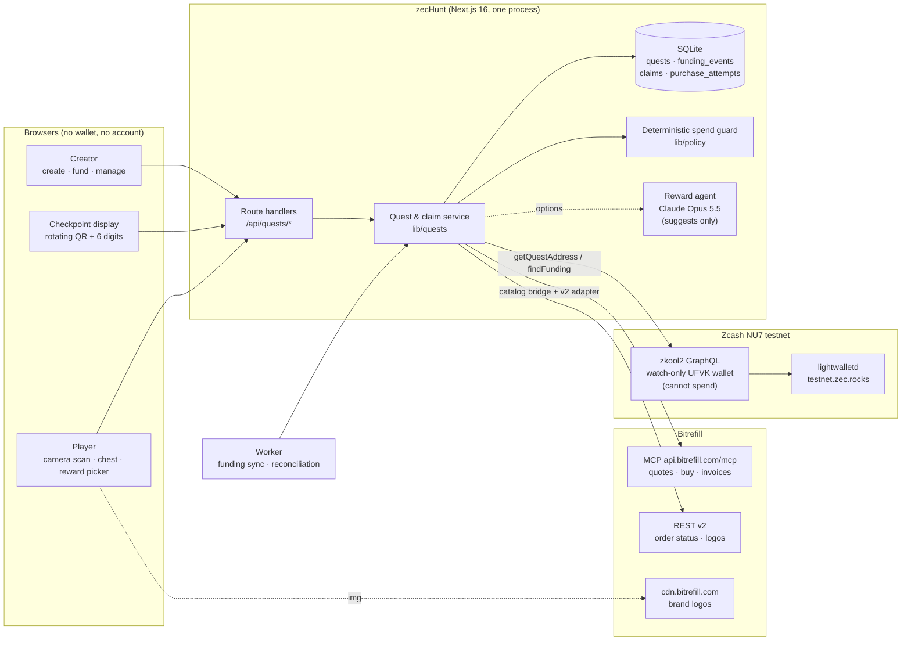
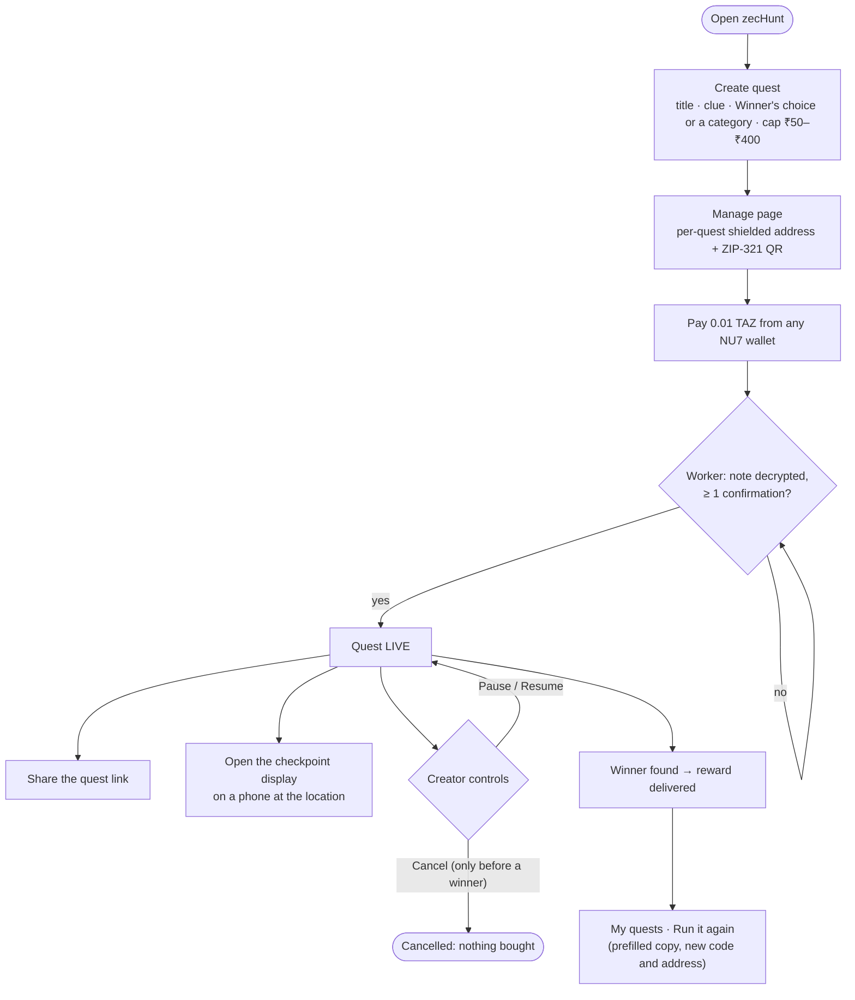
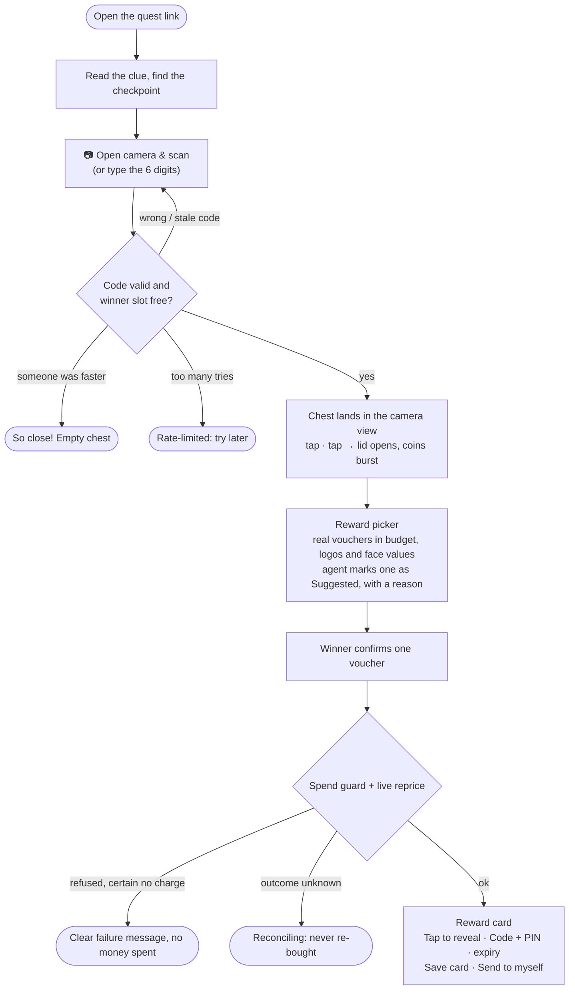
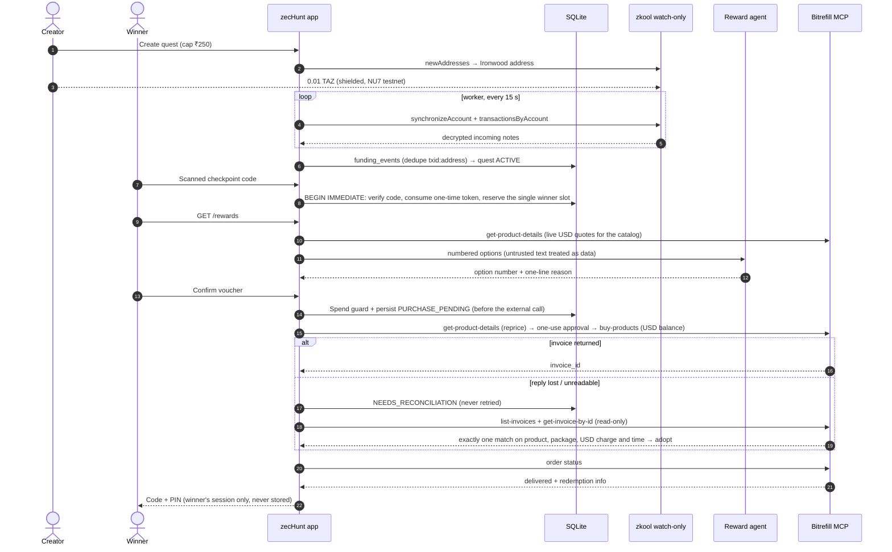

# zecHunt

**Hide a real reward somewhere in the world.** A creator writes a clue, funds the quest privately with a shielded Zcash payment, and shares a link.
Players hunt for the checkpoint and scan its rotating QR code with their phone camera. A treasure chest appears over the camera view.
The first finder opens it, picks a real Bitrefill voucher (an AI agent suggests one), and gets a working code within seconds.
An agent makes the purchase, inside hard limits enforced by the server.

No wallet or account is needed to play.

Built at **Free Society Hack 2026** (Zcash × Bitrefill, Mumbai).

| | |
| --- | --- |
| **Lane** | **Privacy** (shielded quest funding, watch-only detection, no player accounts) **+ Agentic Commerce** (an agent buys real rewards from Bitrefill under deterministic spending rails) |
| **Network** | Zcash NU7 **testnet**, Ironwood shielded pool |
| **Rewards** | Real Bitrefill vouchers for India (food, shopping, gaming), paid from a USD balance |
| **Release** | `v2-hunt` (tag) on `main`; MVP baseline tag `mvp-v1` |

---

## Live evidence

These are real records from the running app on 4 Nov 2026. Mock runs are not included.

### Shielded funding (Zcash NU7 testnet)

Each quest gets its own Ironwood address. 0.01 TAZ sent from any NU7 wallet was decrypted by the watch-only (UFVK) wallet, and the quest went live after 1 confirmation.

| Quest | Amount | Transaction (explorer) |
| --- | --- | --- |
| The lantern at central park | 0.01 TAZ | [`e6e615f2…7723d`](https://zexplorer.app/testnet/tx/e6e615f29e4a58aaba483a15205218cee213d5a2cdb1d5d806100097edd7723d) |
| De dhana dhan | 0.01 TAZ | [`e0521a5f…b95a5`](https://zexplorer.app/testnet/tx/e0521a5fb2f10de1fb256dcfec1fc291ed79bba5479896c3288eb5ede6cb95a5) |
| Jio Dhan Dhan | 0.01 TAZ | [`db013d29…a1689`](https://zexplorer.app/testnet/tx/db013d290e94052b3dd3b9a15d6923aa860118d515ad2bfd6f52c109067a1689) |
| DGS (first app activation) | 0.01 TAZ | [`c1e3d857…1486`](https://zexplorer.app/testnet/tx/c1e3d85793b034160d4caec10ae7d33e01f556c34a9ee96410f0aa523dce1486) |
| Adapter spike (Codex) | 0.01 TAZ | [`800e91d9…1546d`](https://zexplorer.app/testnet/tx/800e91d9394467ac3483d57b60e00c7547fbe2b3c10a0b7db1d11afd95f1546d) |

### Real Bitrefill purchases

| When (IST) | Reward | Paid | Bitrefill invoice ID | How it was delivered |
| --- | --- | --- | --- | --- |
| 4 Nov, 20:35 | Swiggy Money ₹50 | $0.55 from the USD balance | `3923a98e-e06e-4775-b8ea-d0db067a3683` | Delivered. The `buy-products` reply was unreadable, so the claim froze safely (no retry, no second charge). This led to automatic invoice reconciliation. |
| 4 Nov, 22:44 | Swiggy Money ₹50 | $0.55 from the USD balance | `95031003-a1ac-4195-b1fd-2e81c086e51f` | Delivered automatically: the full v2 flow (camera scan, chest reveal, winner's choice from the live catalog, code shown to the winner). |

The USD balance went from $25.00 to **$23.90** after the two purchases ($1.10 spent; read-only preflight, 4 Nov). Voucher codes are never stored or logged; the winner's session re-fetches them from Bitrefill.

---

## System architecture



**Trust boundaries**
- The **watcher wallet holds only a viewing key**, so it can see funding but can never spend.
- The **agent** only ranks options it's given. It answers with an option number, so it can't make up a product, and it never calls a purchase tool.
- **Every purchase passes the spend guard** in the app and an **independent cap ledger** in the Bitrefill adapter.
- A **redemption code** goes from Bitrefill to the winner's browser only. It is never stored or logged.

---

## User flows

### Creator



### Player



---

## Transaction flow



---

## Bitrefill touchpoints

| Touchpoint | Bitrefill API | When | Read-only? |
| --- | --- | --- | --- |
| Catalog discovery (32 India vouchers, code-only) | MCP `search-products`, `get-product-details` | Build time, recorded in `lib/bitrefill/catalog.ts` | ✅ |
| Brand logos | REST `GET /v2/products/{id}` → `cdn.bitrefill.com` | Build time (`refresh-logos.ts`); images load in the picker | ✅ |
| Live quote / reprice | MCP `get-product-details` | When the picker loads, and again right before buying | ✅ |
| Purchase | MCP `buy-products` with `payment_method: balance`, `balance_currency: USD` | Once per claim, after the guard and a one-use approval | ❌ spends |
| Uncertain-purchase recovery | MCP `list-invoices`, `get-invoice-by-id` | Worker, for frozen claims | ✅ |
| Order status and redemption | MCP `get-invoice-by-id` / REST `GET /v2/invoices/{id}`, `/v2/orders/{id}` | Worker and the winner's page | ✅ |
| Balance check | MCP `get-balances` | `scripts/preflight.ts` | ✅ |

Authentication: `Authorization: Bearer <key>` on `https://api.bitrefill.com/mcp`. The documented `/mcp/<key>` path returns 410. Friction we hit is in [FEEDBACK.md](FEEDBACK.md).

---

## Spending caps and rails

| Layer | Limit | Where |
| --- | --- | --- |
| Quest cap (creator picks) | ₹50 / ₹100 / ₹250 / ₹400 → 63¢ / 125¢ / 313¢ / 500¢ (₹88 per $1, plus a 10% margin for repricing) | `lib/money.ts` |
| Per purchase | **$2.76** (`BITREFILL_PER_PURCHASE_CAP_CENTS=276`) | adapter ledger |
| Per day (UTC) | **$5.00** (`BITREFILL_DAILY_CAP_CENTS=500`) | adapter ledger |
| Total campaign | **$5.00** (`BITREFILL_TOTAL_CAP_CENTS=500`), counting earlier spend | adapter ledger |
| Event credit | `BITREFILL_CREDIT_USD`, minus everything reserved | spend guard |
| Approval | One-use, 2-minute approval for any catalog product, capped at min(quest cap, per-purchase cap) | `lib/providers/index.ts` |
| Per claim | One purchase attempt ever. Persisted before the call; uncertain results are reconciled, never retried | app DB and adapter DB |
| Catalog | Hard allowlist of 32 code-only India products; anything that needs a phone number is excluded | `lib/bitrefill/catalog.ts` |

What winners can pick at the current caps: **₹50: 6, ₹100: 18, ₹250: 29, ₹400: 29 of 32** (from `scripts/preflight.ts`).

---

## Status

| Capability | Status | Evidence |
| --- | --- | --- |
| Shielded quest funding (NU7 Ironwood, watch-only UFVK) | ✅ Live | 5 txids above |
| Quest activation after 1 confirmation, dedup by `txid:address` | ✅ Live | quests went live in the running app |
| Rotating checkpoint code + QR (HMAC per 60 s, never stored) | ✅ Live | two-phone runs |
| Camera scan-to-claim + chest reveal | ✅ Live | jsQR + device-tilt parallax; typed fallback |
| One winner per quest (atomic `BEGIN IMMEDIATE`) | ✅ Live + tests | second phone gets "So close!" |
| Rate limits per player / IP / quest | ✅ Live + tests | |
| Winner's choice from a real catalog (32 India vouchers) | ✅ Live | preflight: 29 offered at ₹250 |
| AI suggestion (Claude Opus 5.5, structured output) | ✅ Live | ignores instructions planted in product names; falls back to a fixed rule |
| Real Bitrefill purchase from the USD balance | ✅ Live | 2 invoices above |
| Automatic reconciliation of uncertain purchases | ✅ Live, read-only verified | first invoice re-matched with zero purchases |
| Reward card (tap to reveal, Code/PIN, expiry, save, share) | ✅ Live | |
| Creator controls (pause, resume, cancel, run it again, My quests) | ✅ Live | |
| v2 provider contracts + conformance suite | ✅ Frozen | `docs/CONTRACTS.md` |
| Automated tests | ✅ 79 passing | `npm test` (app, contract, provider) |
| Durable hosting (now a laptop + Cloudflare quick tunnel) | ⏳ Next 30 days | wallet data still in a temp dir |
| Mainnet, real settlement, refunds | ⛔ Not built | testnet TAZ authorizes; Bitrefill credit pays |
| Optional winner TAZ payout | ⛔ Not built | |

The UI shows a red **Simulated** badge on anything produced by a mock provider.

---

## Technologies

- **App:** Next.js 16 (App Router, Turbopack), React 19, TypeScript, Tailwind CSS v4.
- **Data:** SQLite through `node:sqlite` (WAL, one writer, `BEGIN IMMEDIATE`), plus a separate worker process.
- **Zcash:** NU7 testnet, Ironwood pool, [zkool2](https://github.com/hhanh00/zkool2) GraphQL watch-only wallet (UFVK), lightwalletd, ZIP-321 payment QR.
- **Bitrefill:** MCP (JSON-RPC over HTTP/SSE, TOON replies) and REST v2.
- **AI:** Claude Opus 5.5 through `@anthropic-ai/sdk`, with structured output (Zod), server-side refusal fallback and an 8-second timeout.
- **Camera:** `getUserMedia`, `jsQR`, DeviceOrientation parallax, original SVG/CSS chest art.
- **Ops:** production build behind a Cloudflare tunnel; `scripts/preflight.ts` gives a read-only go/no-go before demos.
- **Tests:** `node:test` + `tsx`, a recorded MCP transport, and conformance suites for the provider contracts.

---

## Run it

```bash
npm install
cp .env.example .env.local     # mock providers by default
npm run build && npm start     # http://localhost:3000 (or: npm run dev)
npm run worker                 # funding sync + purchase reconciliation
npm test && npm run typecheck && npm run lint
```

Live mode needs `ZECHUNT_ZCASH_MODE=live` plus a zkool watch-only account ([docs/INTEGRATIONS.md](docs/INTEGRATIONS.md)).
It also needs `ZECHUNT_BITREFILL_MODE=live`, `BITREFILL_API_KEY` and `ZECHUNT_LIVE_PURCHASES=true`, with caps you choose.
An optional `ANTHROPIC_API_KEY` turns on the agent's suggestions.
Before a live demo:

```bash
node --env-file=.env.local --import tsx scripts/preflight.ts   # read-only go/no-go
```

The camera needs HTTPS on phones; `localhost` works on a laptop.

---

## Next 30 days

| Week | Focus | Done when |
| --- | --- | --- |
| **1** | **Recoverable commerce.** Switch the app to the frozen v2 contracts: app-side attempt ledger with `attemptId`, app-minted approvals, a spend-freeze switch, signed high-entropy player cookie, one-time winner recovery key. | Kill the worker mid-purchase → the reward is recovered with zero extra purchases, and the winner gets the code back on a new device. |
| **2** | **Durable beta.** Persistent Linux VM; zkool on a private network with JWT; wallet data off `/tmp`; SQLite backups with a tested restore; supervised worker; health checks and alerts (stalled scans, uncertain purchases, low balance). | Restart everything plus restore a backup on a clean machine → quests, funding and entitlements survive. |
| **3** | **Independent security audit.** Fresh-session adversarial review: code brute force, racing claim tokens, concurrent workers, forged catalog and prices, prompt injection, cookie theft, secrets in logs. Fix every critical finding. | No open critical findings; adversarial tests in CI. |
| **4** | **Repeatable experiences + pilot.** Two-checkpoint quests, reusable templates, minimal creator analytics; run one real event with an organizer in Mumbai. Start mainnet settlement and custody research as a separate memo. | An organizer creates a second quest without help. |

Out of scope until a pilot proves demand: GPS proofs, maps, social feeds, mainnet deposits, automatic real-ZEC payouts.

---

**Docs:** [Privacy](docs/PRIVACY.md) · [Demo script](docs/DEMO.md) · [Integrations](docs/INTEGRATIONS.md) · [Evidence](docs/EVIDENCE.md) · [Contracts](docs/CONTRACTS.md) · [Decisions](docs/DECISIONS.md) · [Zcash spike](docs/ZCASH_SPIKE.md) · [Feedback](FEEDBACK.md)
